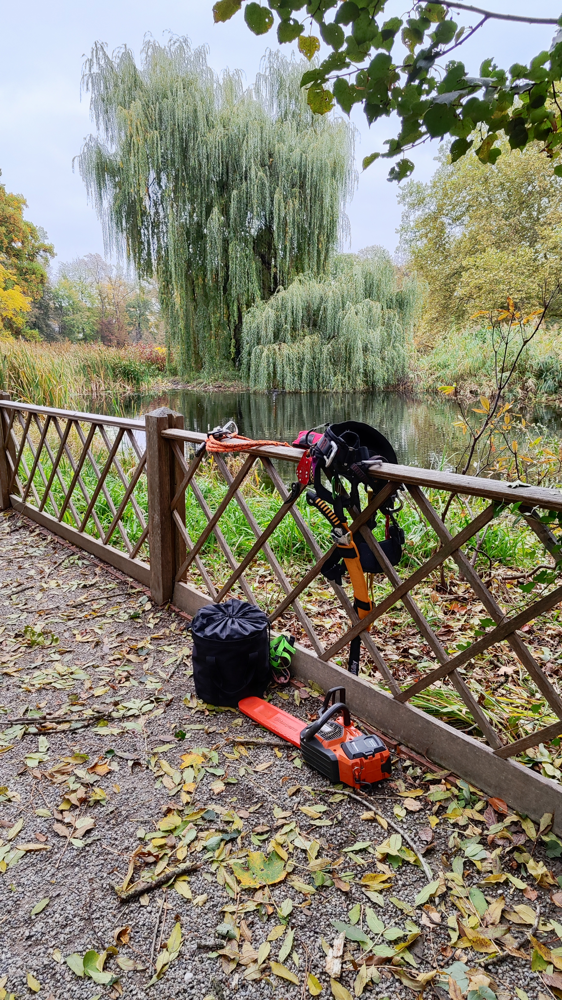

"Das ist doch mein eigener Baum, den kann ich fällen, wann ich will" – dieser Satz führt in Graz schneller zu einer Strafe als man denkt.

In der Landeshauptstadt regelt die Grazer Baumschutzverordnung sehr genau, welche Bäume geschützt sind und wann eine behördliche Genehmigung notwendig ist – auch auf privaten Grundstücken.

<!--more-->

## Ab wann ist ein Baum geschützt?

Innerhalb der Baumschutzzone von Graz sind grundsätzlich alle Bäume ab einem Stammumfang von 50 cm geschützt – gemessen in einer Höhe von einem Meter über dem Boden. Für langsamwüchsige Laubgehölze wie Magnolien gilt schon ein Stammumfang von 25 cm. Das gilt für Bäume auf öffentlichen ebenso wie auf privaten Grundstücken. Eine Ausnahme bilden klassische Obstbäume – nicht ausgenommen sind allerdings Edelkastanien, Maulbeer- und Nussbäume, die oft fälschlich für "normale" Obstbäume gehalten werden.

## Was braucht eine Genehmigung?

Nicht nur die vollständige Fällung ist meldepflichtig. Auch das Kappen von Bäumen und Grabungsarbeiten im Wurzelbereich – etwa für eine neue Zufahrt oder einen Pool – müssen vorher bei der Stadt Graz beantragt werden.

Der Antrag geht an die Abteilung für Grünraum und Gewässer. Praktisch für Antragsteller: Reagiert die Behörde nicht innerhalb von acht Wochen nach Einlangen, gilt der Antrag automatisch als genehmigt. Für die Bearbeitung fallen je nach Anzahl der Bäume und Aufwand der Kommissionierung meist Kosten zwischen 120 und 170 Euro pro Baum an.

## Was kostet eine Fällung ohne Genehmigung?

Wer einen geschützten Baum ohne Antrag entfernt, riskiert eine Verwaltungsstrafe von bis zu 7.267 Euro pro Baum. Das ist deutlich mehr, als eine fachgerechte Fällung samt Antragstellung je kosten würde.

## Mein Tipp für Grundstückseigentümer in Graz

- Vor jeder Fällung, Kappung oder größeren Wurzelarbeit den Stammumfang messen
- Im Zweifel: lieber einen Antrag zu viel stellen als eine Strafe riskieren
- Genügend zeitlichen Puffer einplanen – die Behörde hat acht Wochen Zeit
- Bei der Antragstellung kann eine fachliche Einschätzung (z. B. zur Verkehrssicherheit) den Prozess beschleunigen

Ich unterstütze Sie gerne bei der fachlichen Einschätzung Ihres Baumes und bei der Vorbereitung des Antrags – von der ersten Begutachtung bis zur fachgerechten [Fällung](/leistungen/baumschnitt/) oder [Abtragung](/leistungen/abtragungen/), wenn die Genehmigung erteilt wurde.

**Quellen:** [Stadt Graz – Baumschutz & Baumfällung](https://www.graz.at/cms/beitrag/10214064/15111570/Baumschutz_Baumfaellung.html), [RIS – Grazer Baumschutzverordnung (Rechtsinformationssystem des Bundes)](https://www.ris.bka.gv.at/Dokumente/Gemeinderecht/GEMRE_ST_60101_A17_NSV_148809_2023_0008/GEMRE_ST_60101_A17_NSV_148809_2023_0008.html)
