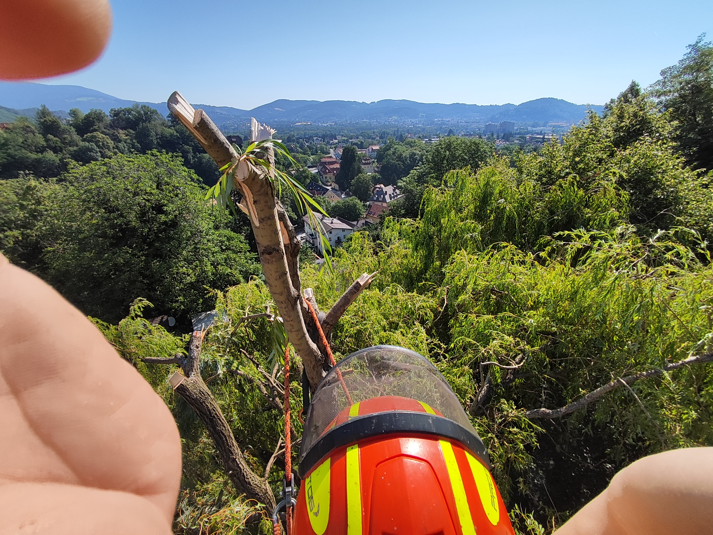

Die klassische Baumkontrolle in Österreich ist in der ÖNORM L1122 klar geregelt: eine regelmäßige, idealerweise jährliche Sichtkontrolle durch geschultes Personal.

Bei Bedarf ergänzt durch Resistograph-Messungen oder Schalltomographie zur Beurteilung der inneren Holzstruktur. Was in diesen Methoden oft zu kurz kommt, ist ein Blick auf das, was sich weit oben in der Krone abspielt.

<!--more-->

## Das blinde Fenster der klassischen Kontrolle

Vom Boden aus lässt sich eine Baumkrone nur bedingt beurteilen. Abgestorbene Kronenteile, Pilzfruchtkörper in großer Höhe, angebrochene Starkäste oder Schäden nach Sturm und Trockenstress bleiben aus der Bodenperspektive oft schlicht verdeckt – von unten sieht man vor allem Blätter, keine Details. Genau hier setzt die Drohneninspektion an: Eine Drohne kann jeden Winkel der Krone anfliegen und aus nächster Nähe fotografieren, ohne dass jemand in die Höhe klettern oder eine Hubarbeitsbühne anrücken muss.

## Wann eine Drohneninspektion besonders sinnvoll ist

- Bei sehr hohen oder alten Bäumen, deren Kronenbereich vom Boden aus kaum einsehbar ist
- Nach Stürmen oder Starkschneefall, wenn viele Bäume in kurzer Zeit kontrolliert werden müssen
- Bei schwer zugänglichen Standorten – etwa an Steilhängen, über Gewässern oder in dicht bebauten Innenhöfen
- Für die Dokumentation im Rahmen der Verkehrssicherungspflicht, wenn ein nachvollziehbarer Bildnachweis gewünscht ist
- Als Ergänzung zur jährlichen Sichtkontrolle, wenn erste Auffälligkeiten am Stammfuß auf ein Problem in der Krone hindeuten

## Rechtlicher Rahmen für den Drohneneinsatz

Drohnenflüge in Österreich unterliegen den EU-weiten Regeln der "Open"-Kategorie und werden über die staatliche Luftfahrtbehörde Austro Control auf der Plattform dronespace.at verwaltet. Für die meisten Baumkontrollen reicht ein Betrieb in der offenen Kategorie mit entsprechendem Kompetenznachweis – eine kostenpflichtige Sondergenehmigung ist nur in eingeschränkten Flugzonen nötig.

## Drohne ersetzt nicht den Fachmann – sie unterstützt ihn

Eine Drohne liefert Bilder – die fachliche Einschätzung, ob ein Schadbild kritisch ist oder nicht, bleibt weiterhin Aufgabe eines erfahrenen Baumpflegers. Die Kombination aus Erfahrung am Boden und Bildmaterial aus der Krone macht die Beurteilung aber deutlich präziser, vor allem bei Bäumen, die sonst nur mit erheblichem Aufwand – etwa per Seilklettertechnik – überhaupt einsehbar wären.

Sie möchten einen hohen oder schwer zugänglichen Baum kontrollieren lassen, ohne dass dafür geklettert werden muss? Mit meiner [Drohneninspektion](/leistungen/drohneninspektion/) bekommen Sie schnell und ohne großen Aufwand einen fundierten Überblick über den Zustand Ihrer Baumkrone.

**Quellen:** [Österreichische Bundesforste – Baumkontrolle und Baumkataster](https://www.bundesforste.at/leistungen/dienstleistungen/baumkontrolle-und-baumkataster.html), [dronespace.at – die Austro Control Drohnenplattform](https://www.dronespace.at/)
