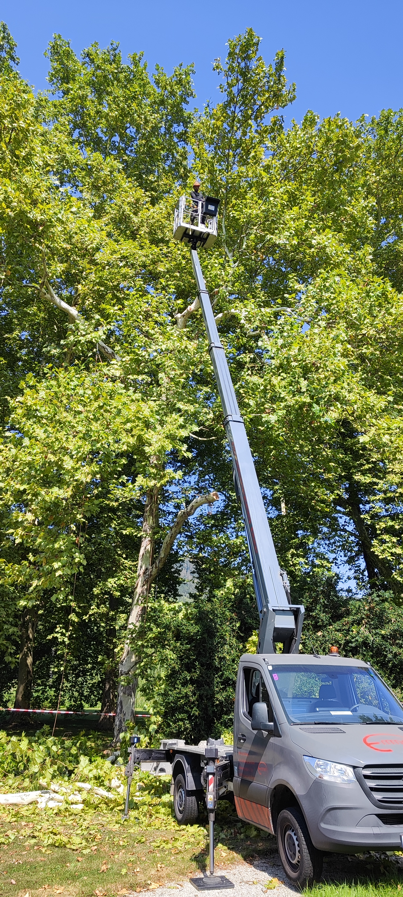

Der Sommer 2026 macht vielen Bäumen in der Steiermark zu schaffen.

Nach einem schneearmen Winter waren die Waldböden schon zu Frühlingsbeginn vielerorts zu trocken, die Wasserspeicher weitgehend erschöpft. Der WWF Österreich warnt in seiner Winterbilanz Wald ausdrücklich vor einem schwierigen Waldjahr 2026 – mit spürbaren Folgen bis in Privatgärten und Grazer Straßenzüge.

<!--more-->

## Warum Trockenheit gefährlicher ist, als man denkt

Hohe Temperaturen und verstärkte Verdunstung setzen Bäume unter Stress und schwächen ihre natürlichen Abwehrmechanismen – etwa die Harzproduktion bei Nadelbäumen. Ein geschwächter Baum ist dadurch deutlich anfälliger für Pilzkrankheiten und Schädlinge wie den Borkenkäfer. Trockenstress wirkt also nicht nur direkt, sondern öffnet auch die Tür für weitere Probleme.

## Diese Warnzeichen sollten Sie jetzt beachten

Je nach Baumart zeigen sich die Symptome unterschiedlich:

- **Ahorn und Linde:** braune Nekrosen (abgestorbenes Gewebe) am Blattrand, bei Linden teils zusätzlich gelb verfärbte Blätter
- **Buche:** seit Ende Juli auffällig braun verfärbte Kronenteile, die schon von Weitem sichtbar sind
- **Erle:** vorzeitiger Laubabwurf an trockenen Standorten, oft schon im Hochsommer

Besonders betroffen sind laut aktuellen Beobachtungen Regionen mit Niederschlagsdefiziten von 50 bis 70 Prozent gegenüber dem langjährigen Mittel. Auch in der Steiermark und rund um Graz sind solche Defizite in trockenen Sommerphasen keine Seltenheit.

## Was tun, wenn Ihr Baum Stresssymptome zeigt?

Nicht jedes braune Blatt bedeutet gleich einen kranken Baum – aber ignorieren sollte man die Signale nicht:

- Beobachten Sie, ob sich die Symptome über mehrere Wochen ausbreiten oder stabil bleiben
- Vermeiden Sie unnötigen Rückschnitt an bereits gestressten Bäumen – jede Schnittwunde ist eine zusätzliche Belastung
- Bei jungen oder frisch verpflanzten Bäumen hilft regelmäßiges, tiefes Gießen in den Abendstunden
- Bei älteren, großen Bäumen mit deutlichen Kronenschäden lohnt sich eine fachliche Einschätzung, ob ein gezielter Pflegeschnitt oder eine Kroneneinkürzung sinnvoll ist

## Trockengestresste Kronen im Blick behalten

Gerade bei großen, alten Bäumen ist eine trockenheitsbedingt geschwächte Krone aus der Ferne oft schwer zu beurteilen – abgestorbene Astpartien können brechen, ohne dass man es vom Boden aus erkennt. Eine [Drohneninspektion](/leistungen/drohneninspektion/) macht solche Schäden sichtbar, ohne dass jemand in die Krone klettern muss.

Sie beobachten an einem Ihrer Bäume Verfärbungen, vorzeitigen Laubabwurf oder abgestorbene Kronenteile? Ich schaue mir das gerne fachkundig vor Ort an und berate Sie zu den nächsten Schritten.

**Quellen:** [WWF Österreich – Winterbilanz Wald: Warnung vor Trockenheit und schwierigem Waldjahr 2026](https://www.wwf.at/winterbilanz-wald-wwf-warnt-vor-trockenheit-und-schwierigem-waldjahr-2026/), [ooe.ORF.at – Trockenheit setzt Bäume unter Stress](https://ooe.orf.at/stories/3360873/)
